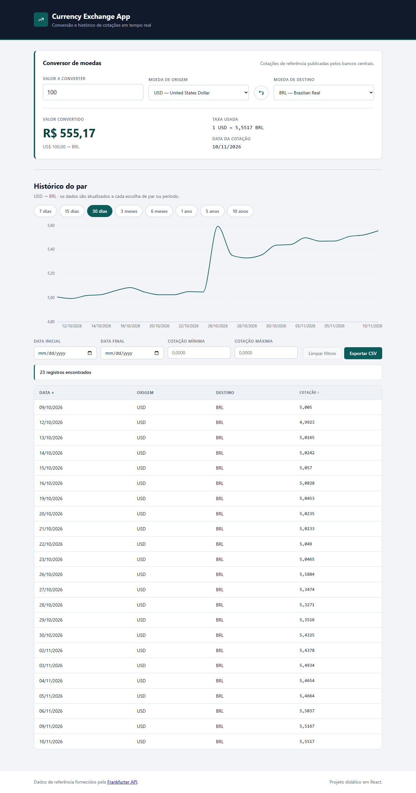
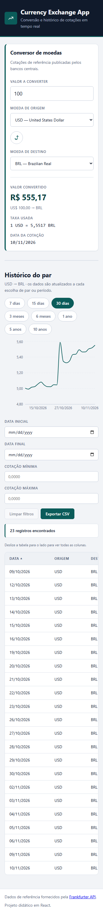
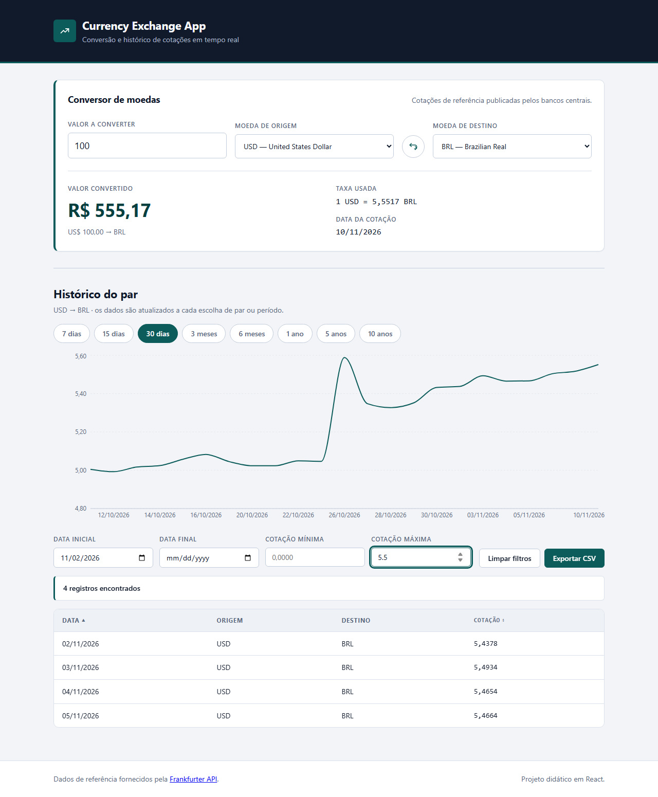

# Currency Exchange App

Aplicação web (SPA) em **React** que converte moedas e mostra a evolução histórica
das cotações, usando a API pública [Frankfurter](https://frankfurter.dev) — sem
chave de API, sem cadastro e sem back-end.

O projeto foi escrito para **ser estudado**: o código é simples, commentado nos
pontos-chave e a lógica de negócio está isolada em funções puras que podem ser
testadas sem navegador e sem internet.

---

## Funcionalidades

- **Conversor de moedas** com escolha de moeda de origem e destino, validação do
  valor em tempo real e resultado calculado pela aplicação (`valor × taxa`).
- **Cotação atual**: taxa utilizada e **data efetiva** da cotação.
- **Inverter moedas**: troca origem e destino mantendo o valor digitado.
- **Histórico em gráfico de linha** (Recharts) com 8 períodos: 7 dias, 15 dias,
  30 dias, 3 meses, 6 meses, 1 ano, 5 anos e 10 anos.
- **Tabela** com Data, Origem, Destino e Cotação.
- **Filtros combináveis**: data inicial, data final, cotação mínima e cotação máxima.
- **Ordenação** por Data e por Cotação, em ordem crescente e decrescente.
- **Exportação em CSV** apenas dos registros filtrados, na ordem exibida.
- **Estados de interface** completos: carregando, erro de API e "nenhum resultado".
- **Responsivo** de 360 px até desktop (a tabela rola dentro do próprio contêiner).

## Tecnologias

| Camada | Tecnologia | Por quê |
| ------ | ---------- | ------- |
| Interface | **React 18** (JSX, JavaScript) | Composição da UI e estado local |
| Build | **Vite 6** | Servidor de desenvolvimento rápido e build de produção |
| Estilos | **CSS Modules** + variáveis CSS | Um arquivo `.module.css` por componente, sem lib de estilo |
| Gráfico | **Recharts 3** | Gráfico de linha com `Tooltip` e eixos formatados |
| Requisição | **`fetch` + `async/await`** | Sem axios, sem biblioteca de estado |
| Testes | **`node --test`** (runner nativo do Node) | Testes unitários sem dependência extra |
| Lint | **Oxlint** | Análise estática rápida |

**Propositalmente NÃO usados:** Redux, Context API, React Query, Tailwind, MUI/Chakra,
Papa Parse, date-fns, axios. Nada de autenticação, back-end, banco de dados ou
pagamentos.

## Pré-requisitos

- **Node.js 18+** (testado com 22.11.0) e **npm 9+**.
- Acesso à internet para a API de cotações (a aplicação funciona sem, mas mostra
  o estado de erro).

## Instalação

```bash
npm install
```

## Execução

```bash
npm run dev
```

Abra <http://localhost:5173>.

## Build de produção

```bash
npm run build      # gera a pasta dist/
npm run preview    # serve o build de produção
```

O Recharts é carregado **sob demanda** (`lazy` + `Suspense`), então o JavaScript
inicial da aplicação tem apenas ~23 kB (8 kB compactado).

## Testes

```bash
npm test           # 50 testes unitários com o runner nativo do Node
npm run lint       # análise estática com o Oxlint
```

Os testes ficam ao lado das funções que testam (`src/utils/*.test.js`) e rodam
**sem internet**, porque cobrem apenas as funções puras.

Para conferir a API de verdade (precisa de internet):

```bash
node scripts/verificar-colecao.mjs
```

## Arquitetura resumida

```
src/
├── components/        cada componente tem seu .jsx e seu .module.css
│   ├── App.jsx        estado compartilhado (lifting state up)
│   ├── Converter.jsx  campo de valor, moedas, inversão e resultado
│   ├── CurrencySelect.jsx
│   ├── HistoryTable.jsx  filtros, ordenação e exportação CSV
│   ├── PeriodSelector.jsx
│   ├── RateChart.jsx  gráfico do Recharts
│   └── StatusMessage.jsx  loading / erro / vazio
├── hooks/             useCurrencies, useLatestRate, useHistory
├── services/          frankfurter.js (fetch + async/await)
├── utils/             converter, dates, filters, csv (+ testes)
├── constants/         periods.js
├── index.css          variáveis CSS globais (cores, espaços, fontes)
└── App.module.css
```

O fluxo de dados é sempre nesta direção:

```
API  ->  services  ->  hooks  ->  App (estado)  ->  components  ->  tela
```

- **Nenhum componente busca dado.** Quem busca é o hook.
- **Nenhum componente guarda o estado de outro.** O `App` guarda o estado
  compartilhado e distribui por `props` (*lifting state up*); o `HistoryTable`
  guarda apenas o estado que só ele usa (os filtros e a ordenação).
- **Nenhuma lógica de negócio dentro do JSX.** Conversão, filtros, ordenação e
  CSV vivem em `src/utils/`, em funções puras e testáveis.

## Screenshots

| Desktop | Mobile |
| ------- | ------ |
|  |  |

Tabela com filtros aplicados:



## Documentação

| Arquivo | Conteúdo |
| ------- | -------- |
| [`docs/REQUIREMENTS.md`](docs/REQUIREMENTS.md) | Requisitos funcionais (RF), não funcionais (RNF), regras de negócio (RN) e critérios de aceite |
| [`docs/COMPONENTS.md`](docs/COMPONENTS.md) | Mapa de componentes, props, estados e relações |
| [`docs/API_TESTS.md`](docs/API_TESTS.md) | Resultado **real** dos testes na API e divergências em relação à documentação oficial |
| [`docs/FUNCTION_TESTS.md`](docs/FUNCTION_TESTS.md) | Casos testados por função: entrada, saída esperada e resultado |
| [`docs/FIGMA.md`](docs/FIGMA.md) | Esqueleto do design (a ser preenchido pelo aluno) |
| [`docs/AI_USAGE.md`](docs/AI_USAGE.md) | Uso de IA no projeto e o que precisa ser revisado |

## Observações sobre a API

A aplicação usa a **v1** da Frankfurter (`https://api.frankfurter.dev/v1`), que
continua funcionando, embora a documentação atual do site recomende a **v2**
(parâmetros e formato de data diferentes). O histórico completo dessas diferenças
está em [`docs/API_TESTS.md`](docs/API_TESTS.md).

Dois comportamentos que a aplicação trata de propósito:

1. **Par igual** (origem = destino) devolve erro 422 na API — a aplicação nem
   chega a fazer a chamada: a taxa vale 1 e o histórico mostra
   "Escolha moedas diferentes para ver o histórico.".
2. **Data sem cotação** (fim de semana, feriado) **não** é erro: a API devolve
   200 encaixando no dia útil mais próximo. Por isso o app usa a data efetiva
   devolvida pela API e nunca assume "um ponto por dia".

## Licença

Projeto didático. Os dados de câmbio são fornecidos pela
[Frankfurter API](https://frankfurter.dev), sob a licença dela.
